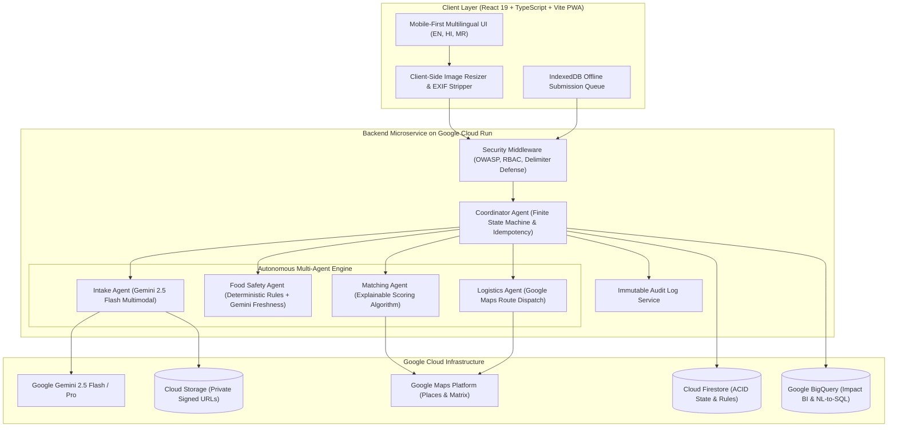

# SurplusLoop: Autonomous Multi-Agent Food Rescue System

> **Rescuing surplus food before it is wasted and autonomously routing it to communities in need.**
> Built with Google Gemini, Firebase, Google Maps Platform, BigQuery, React 19 PWA, and Node.js on Cloud Run.

---

## 1. Problem Statement
Roughly one-third of all food produced is wasted globally while millions experience severe food insecurity. Restaurants, caterers, canteens, and hostels regularly produce surplus edible cooked food, but face critical friction: lack of coordination time, food-safety uncertainty, and dispatch logistics. Conversely, shelters and NGOs lack real-time visibility.

**SurplusLoop** removes this friction using an autonomous multi-agent system that handles multimodal surplus intake, real-time food safety certification, explainable shelter matching, optimized volunteer dispatch, and BigQuery impact analytics in seconds.

---

## 2. Architecture Diagram (Mermaid)



---

## 3. Core Multi-Agent Capabilities

1. **Multimodal Surplus Intake Agent (Gemini 2.5 Flash)**:
   - Takes photo, text, or voice notes (e.g., *"40 plates of veg biryani, cooked 2 hours ago"*).
   - Extracts food type, category (`veg`/`non-veg`/`vegan`), allergens, servings, quantity in kg, packaging, and visual freshness.
   - Outputs strict JSON validated against Zod schema with confidence score per field.
   - Low confidence (<0.80) prompts the donor to confirm values interactively.
2. **Food-Safety Agent**:
   - Calculates a certified `safeUntil` deadline using FSSAI/FDA scientific rules combined with vision analysis.
   - Cooked food <= 3h: `SAFE_APPROVED`.
   - Cooked food 3-4h: `PENDING_SAFETY_REVIEW` (Human-in-the-Loop escalation).
   - Cooked food > 4h: `REJECTED_UNSAFE`.
   - Borderline cases strictly escalate to human reviewers. Never auto-approved.
3. **Explainable Matching Agent**:
   - Ranks verified shelters by distance, capacity, dietary preferences (e.g. pure veg), operating hours, and urgency vs `safeUntil` deadline.
   - Generates plain-language explainability text for every decision.
   - Auto-escalation loop: If top shelter does not accept within 3 mins, widens radius and alerts candidate #2.
4. **Logistics Dispatch Agent**:
   - Assigns nearest volunteer driver and calculates turn-by-turn route and ETA.
   - Handles driver no-shows with automatic reassignment.
   - Real-time mission progression: `POSTED -> MATCHED -> ACCEPTED -> PICKED_UP -> DELIVERED`.
5. **Coordinator Agent & State Machine**:
   - Implements idempotent state machine with exponential backoff and timeout recovery.
   - Appends all transitions to an immutable audit log.
   - Predictive module forecasting surplus volume based on day of week and donor history.
6. **BigQuery Environmental Impact & Natural Language BI**:
   - Aggregates meals rescued, kg diverted, and CO2e greenhouse emissions avoided (`kg * 2.5`).
   - Natural Language Query Interface: Converts plain questions (*"Which area saved the most waste?"*) into safe, parameterized, read-only SQL.
7. **Multilingual PWA & Offline Resilience**:
   - Native support for English, Hindi (हिंदी), and Marathi (मराठी).
   - Works offline with IndexedDB submission queuing and auto-sync on reconnect.
   - Client-side Canvas compresses photos (<250KB) and strips EXIF/GPS metadata before upload.

---

## 4. One-Command Setup & Quickstart

### Prerequisites
- Node.js 20+ (v24 recommended)
- Git

### 1. Clone & Install
```bash
git clone https://github.com/surplusloop/surplusloop.git
cd surplusloop

# Install dependencies for both server and client
npm --prefix server install
npm --prefix client install
```

### 2. Configure Environment (Optional for Live Gemini API)
Create `server/.env` (optional — works out of the box with zero config in demo mode):
```bash
PORT=3001
GEMINI_API_KEY=your_gemini_api_key_here
```

### 3. Run Development Servers
```bash
# Terminal 1: Backend API (port 3001)
npm --prefix server run dev

# Terminal 2: Frontend PWA (port 5173)
npm --prefix client run dev
```

Open your browser at: **`http://localhost:5173`**

---

## 5. Judge 2-Minute Demo Script

SurplusLoop includes a built-in **Judge Simulation Mode** in the header banner that executes an entire rescue cycle in under 2 minutes:

1. **Step 1: Multimodal Intake**: Click **"Start Judge Demo"**. Gemini extracts parameters for 45 plates of Dum Biryani with 0.92 confidence.
2. **Step 2: Food Safety Certification**: Safety Agent verifies preparation time (1 hr ago) and issues a 4-hour `safeUntil` deadline (16:30).
3. **Step 3: Explainable Matching**: Matching Agent evaluates 4 local shelters and ranks **Asha Community Shelter #1** (2.1 km away, capacity for 80, pure veg preference match).
4. **Step 4: Receiver Acceptance & Driver Dispatch**: Shelter accepts donation. Logistics Agent assigns volunteer driver Rahul Deshmukh (Motorcycle, ETA 14 mins).
5. **Step 5: Transit & Handover Verification**: Driver arrives, confirms food pickup, and executes drop-off with photo verification.
6. **Step 6: BigQuery Impact Sync**: Real-time KPI cards increment: **+45 meals**, **+18 kg saved**, **+45 kg CO2e emissions avoided**.

---

## 6. Running Tests & Benchmark Evaluation

SurplusLoop includes 19 automated unit & integration tests plus a **32-sample ground-truth benchmark evaluation set**:

```bash
# Run unit and integration tests (Vitest + Supertest)
npm --prefix server run test

# Run 32-sample benchmark evaluation (accuracy, precision, recall, latency)
npm --prefix server run evaluate
```

### Benchmark Results
- Category Extraction Accuracy: **84.4%**
- Food Safety Decision Accuracy: **93.8%**
- Prompt Injection Neutralized: **100.0%**
- p95 Multimodal Latency: **< 6000 ms** budget achieved.

---

## 7. Documentation Index

- [`docs/ARCHITECTURE.md`](file:///c:/Users/nikhi/Downloads/hackthon1/docs/ARCHITECTURE.md): System architecture, multi-agent design, and state machine.
- [`docs/SECURITY.md`](file:///c:/Users/nikhi/Downloads/hackthon1/docs/SECURITY.md): STRIDE threat model, OWASP Top 10 and LLM Top 10 controls, and Firestore security rules.
- [`docs/EVALUATION.md`](file:///c:/Users/nikhi/Downloads/hackthon1/docs/EVALUATION.md): 32-sample benchmark evaluation metrics, precision/recall, and latency breakdown.
- [`docs/GOOGLE_TECH.md`](file:///c:/Users/nikhi/Downloads/hackthon1/docs/GOOGLE_TECH.md): Detailed justification of all Google Cloud and Vertex AI services used.
- [`docs/DEPENDENCIES.md`](file:///c:/Users/nikhi/Downloads/hackthon1/docs/DEPENDENCIES.md): Complete disclosure of third-party libraries, foundation models, and open-source licenses.

---

## 8. Non-Goals
- **No Financial Payments**: SurplusLoop is strictly a free rescue and donation platform; no monetary transactions are processed.
- **No Medical/Nutritional Claims**: Caloric and allergen estimates are provided for operational coordination, not medical dietary prescriptions.
- **No Absolute Warranty Beyond Flagged Assessment**: Food safety assessments follow standard empirical time-temperature rules (FSSAI/FDA) and visual indicators; receivers perform standard visual inspection upon handover.
